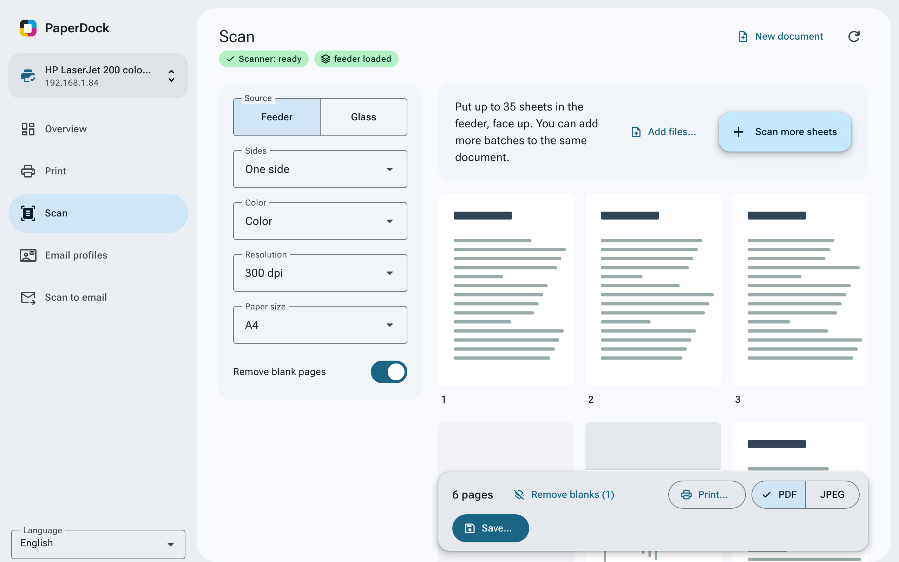

# PaperDock

I was really tired of being forced to use the garbage software provided by printer vendors. HP is the only brand I currently have, but I imagine the situation is similar with other manufacturers. So I decided to build an interface to make their printers easier to configure and use.
So far, I’ve only tested it with my two HP printers, and it’s not complete yet. If you’d like to try it with your own printers and contribute, I’d be happy to integrate your changes.
The goal is to replace the vendor's default software altogether: PaperDock needs no drivers, talks to the printer directly over open standards, works around the quirks of old firmware that vendors no longer fix, and runs on all major operating systems (macOS, Windows and Linux). For now it focuses on the features I need most, such as scanning documents in batches from the feeder and adding existing PDFs or images to a scan.

The text below is completely LLM generated, consider it as documentation.

Cross-platform (macOS, Linux, Windows) app to manage network printers and scanners
of any brand. Built with Tauri 2 (Rust) + React. UI in Italian and English.



<p align="center">
  
  
</p>

It speaks open standards first and vendor APIs only as extras:

| Protocol | Brands | Used for |
|---|---|---|
| mDNS / Bonjour | all | finding devices |
| IPP | virtually all network printers | model, state, supply levels, printing (PDF) |
| eSCL (AirScan) | HP, Canon, Epson, Brother, Xerox, Kyocera, Ricoh, Lexmark… | scanning |
| WS-Scan (WSD) | most devices Windows can scan from | scanning when eSCL is missing or cloud-only |
| HP LEDM | HP | cartridge numbers, alerts, scan-to-email profiles |

Tabs appear only for what the device supports.

## Download

Installers for macOS (Apple silicon and Intel), Windows and Linux are on the
[Releases](https://github.com/sim186/paperdock/releases) page.

The builds are not code-signed yet, so the OS warns the first time:

- **macOS**: right-click PaperDock in Applications → Open → Open. Or run
  `xattr -dr com.apple.quarantine /Applications/PaperDock.app`.
- **Windows**: SmartScreen → More info → Run anyway.
- **Linux**: `chmod +x PaperDock_*.AppImage`, or install the `.deb` / `.rpm`.

## Features

- **Discovery** of printers and scanners on the LAN; remembers what it found
- **Overview**: state, translated alerts, supply levels, device info
- **Batch scanning** from the document feeder: scan loads of sheets into one
  document, add more loads, reorder/rotate/delete pages, save as PDF or JPEG
- **Double-sided**: automatic on duplex feeders; on simplex feeders (e.g. HP M276n)
  a guided manual mode scans the fronts, asks to flip the stack, scans the backs
  and interleaves the pages
- **Blank page removal**
- **Import files into a scan**: add PDF pages and images to the scanned document
- **Printing** of PDF files and images (drag & drop or file picker, several files as
  one job): copies, page ranges, pages per sheet (1–16), orientation, rotation,
  fit to paper, color / black & white, paper size, two-sided (automatic when the
  printer has it, otherwise guided manual flip). Pages are laid out in the app
  with pdf-lib and sent as one PDF with IPP Print-Job, so the printer only needs
  to accept `application/pdf`.
- **HP**: email profiles (SMTP accounts) and scan-to-email defaults
- **Status messages**: results (printed, saved, failed…) and progress of long jobs
  in a Material 3 snackbar; light and dark theme

Tested on HP LaserJet 200 colorMFP M276n and HP DeskJet 3700.

## Develop

```sh
npm install
npm run tauri dev
```

Tests:

```sh
npm test                                     # frontend tests, simulated backend
cd src-tauri
cargo test                                   # unit tests, offline
PAPERDOCK_HOST=192.168.1.84 cargo test live -- --ignored --nocapture   # read-only, real device
```

Build installers for the current OS: `npm run tauri build`.

## Release

GitHub Actions (`.github/workflows/`):

- `ci.yml`: on every push to `main` and every pull request, typechecks and builds
  and tests the frontend and runs `cargo test`.
- `release.yml`: builds the installers on macOS, Windows and Linux and attaches
  them to a **draft** release. To release:

  ```sh
  npm version minor        # or patch / major: 0.1.0 → 0.2.0
  git push --follow-tags
  ```

  then review the draft on the Releases page and publish it. Run by hand from the
  Actions tab, the workflow only builds and attaches the installers to the run as
  artifacts (handy to test a branch).

### Versioning

[Semantic versioning](https://semver.org): `major` for changes that break saved
settings or drop a supported OS, `minor` for features, `patch` for fixes.
`package.json` is the only place the version is written: `tauri.conf.json` reads it,
and `npm version` copies it into `src-tauri/Cargo.toml` / `Cargo.lock`
(`scripts/sync-version.mjs`), commits as `X.Y.Z` and tags `vX.Y.Z`. Pushing the tag
starts the release build, which fails if the tag and `package.json` disagree.

## Layout

| Path | Purpose |
|---|---|
| `src-tauri/src/client.rs` | HTTP wrapper bound to one printer |
| `src-tauri/src/device.rs` | Feature probe, vendor-neutral overview |
| `src-tauri/src/ipp.rs` | Minimal IPP client (Get-Printer-Attributes) |
| `src-tauri/src/escl.rs` | Scanner capabilities, status, scan jobs |
| `src-tauri/src/session.rs` | Batch scan session, manual duplex, blank detection |
| `src-tauri/src/ledm.rs` | HP: status, supplies, email profiles, scan-to-email |
| `src-tauri/src/pdf.rs` | JPEG → PDF without re-encoding |
| `src-tauri/src/discovery.rs` | mDNS browse |
| `src/snackbar.tsx` | Status snackbar (queue, kinds, progress, actions) |
| `src/printing.ts` | Load PDFs/images, page ranges, sheet layout, rasterizing (pdf-lib, pdf.js) |
| `src/i18n.tsx` | Italian / English strings |
| `src/views/*` | React screens |

## Protocol notes

- Scanning picks eSCL when it works, else WS-Scan. Some old HP firmware (e.g. M276n)
  exposes a cloud-only eSCL ("CloudScan") with no `NextDocument`: jobs are rejected
  with HTTP 400, so PaperDock detects it via `eSclManifest.xml` and uses WS-Scan.
- WS-Scan service ports change on reboot; they are found with a unicast WS-Discovery
  probe (UDP 3702) and a WS-Transfer Get on the device metadata address.

- LEDM endpoints are discovered from `/DevMgmt/DiscoveryTree.xml`; the email service
  lives under `/DevMgmt/Email` (`Accounts`, `Contacts`, `ScanToEmailDyn.xml`).
- Field names, lengths and allowed values come from the `*Cap.xml` documents.
- Passwords and PINs are write-only on the device: they are never read back.
- The printer's EWS has **no authentication by default**: anyone on the LAN can
  change these settings. Set an admin password in the EWS.

## Not yet verified on the device

Printing: a 2-page PDF composed by the app printed fine on the M276n. Sending the
`media` attribute made that printer abort the job (`aborted-by-system`), so
PaperDock sends only attributes that differ from the defaults. Its 2013 PDF
interpreter also aborts some modern PDFs (e.g. made with Canva): PaperDock
follows each job with Get-Job-Attributes and, when one is aborted without
printing, resends the sheets as 300 dpi pictures in a plain PDF
("compatibility mode", then remembered for that printer). Copies,
black & white and the manual two-sided flow have not been tried on paper yet.

The write paths (create/update/delete/test profile, saving scan-to-email settings,
manual duplex on paper) are built from the device's capability documents but have not been
exercised against the real printer yet. Feeder scanning via WS-Scan was verified
on the M276n. In particular the element holding a profile's
entry id is undocumented; `ledm::entry_id` accepts the common LEDM spellings.

## License

[MIT](LICENSE)
