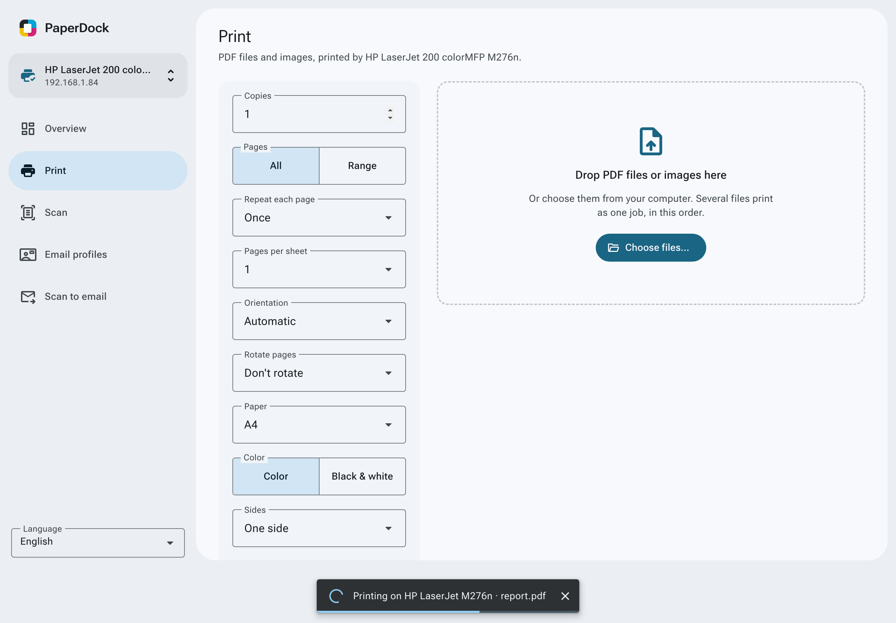
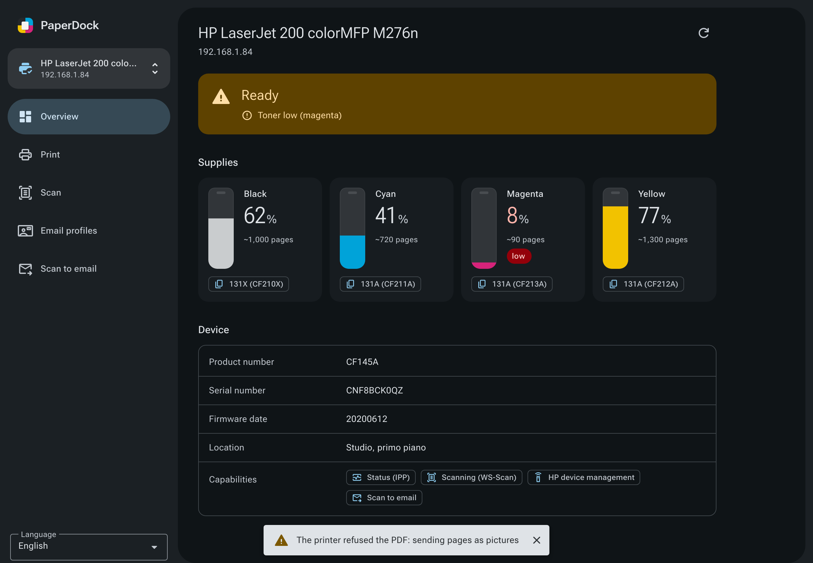
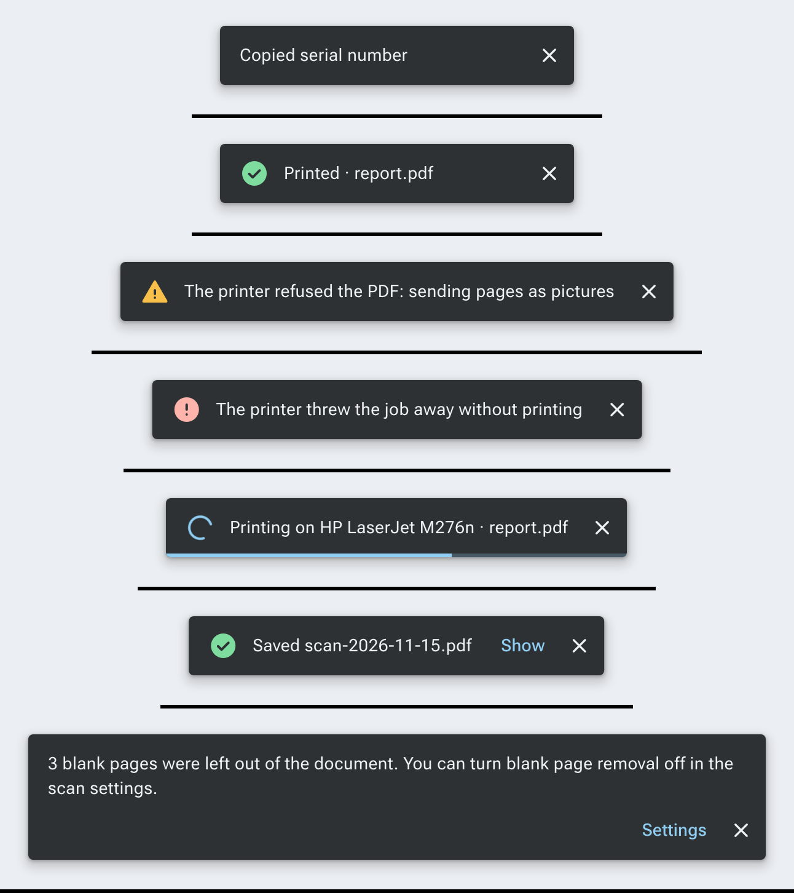
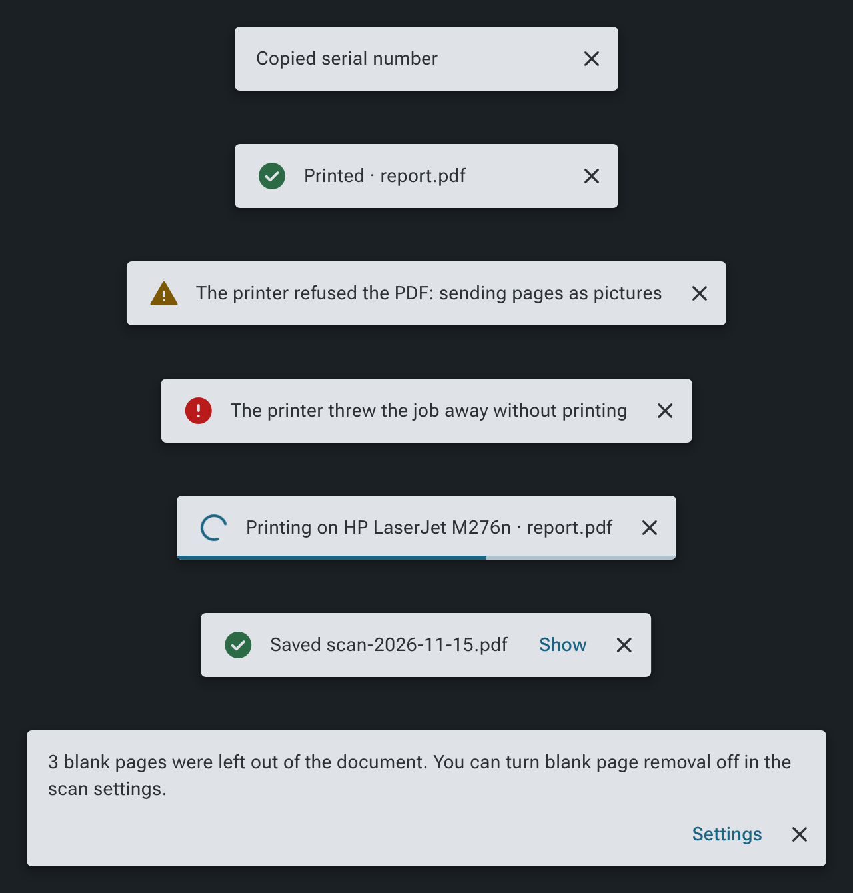

# PaperDock

Cross-platform (macOS, Linux, Windows) app to manage network printers and scanners
of any brand. Built with Tauri 2 (Rust) + React. UI in Italian and English.



<p align="center">
  
  
</p>

It speaks open standards first and vendor APIs only as extras:

| Protocol | Brands | Used for |
|---|---|---|
| mDNS / Bonjour | all | finding devices |
| IPP | virtually all network printers | model, state, supply levels, printing (PDF) |
| eSCL (AirScan) | HP, Canon, Epson, Brother, Xerox, Kyocera, Ricoh, Lexmark… | scanning |
| WS-Scan (WSD) | most devices Windows can scan from | scanning when eSCL is missing or cloud-only |
| HP LEDM | HP | cartridge numbers, alerts, scan-to-email profiles |

Tabs appear only for what the device supports.

## Features

- **Discovery** of printers and scanners on the LAN; remembers what it found
- **Overview**: state, translated alerts, supply levels, device info
- **Batch scanning** from the document feeder: scan loads of sheets into one
  document, add more loads, reorder/rotate/delete pages, save as PDF or JPEG
- **Double-sided**: automatic on duplex feeders; on simplex feeders (e.g. HP M276n)
  a guided manual mode scans the fronts, asks to flip the stack, scans the backs
  and interleaves the pages
- **Blank page removal**
- **Import files into a scan**: add PDF pages and images to the scanned document
- **Printing** of PDF files and images (drag & drop or file picker, several files as
  one job): copies, page ranges, pages per sheet (1–16), orientation, rotation,
  fit to paper, color / black & white, paper size, two-sided (automatic when the
  printer has it, otherwise guided manual flip). Pages are laid out in the app
  with pdf-lib and sent as one PDF with IPP Print-Job, so the printer only needs
  to accept `application/pdf`.
- **HP**: email profiles (SMTP accounts) and scan-to-email defaults

Tested on HP LaserJet 200 colorMFP M276n and HP DeskJet 3700.

## Status snackbar

Results of what you do (printed, saved, copied, failed…) appear in a
[Material 3 snackbar](https://m3.material.io/components/snackbar/overview) at the
bottom of the window. It lives in [`src/snackbar.tsx`](src/snackbar.tsx) and has no
dependencies beyond React.

| Light | Dark |
|---|---|
|  |  |

```tsx
const snack = useSnackbar();

snack("Copied serial number");                       // info, 4 s
snack("Printed · report.pdf", { kind: "success" });
snack("Toner low", { kind: "warning" });             // 8 s
snack(errorText(e), { kind: "error" });              // 8 s, role="alert"
snack("Saved scan.pdf", { kind: "success", action: { label: "Show", run: reveal } });

// Long-running work: one snackbar that changes state in place.
const job = snack("Sending…", { kind: "progress" }); // stays until updated
job.update("Printing…", { progress: 0.5 });          // determinate bar
job.update("Printed", { kind: "success" });          // now times out as usual
job.dismiss();
```

| Option | Meaning |
|---|---|
| `kind` | `info` (default, no icon), `success`, `warning`, `error`, `progress` |
| `action` | `{ label, run }`: a text button; long messages move it to its own row |
| `duration` | ms on screen, `null` to stay until dismissed. Default 4 s, 8 s for errors, warnings and snacks with an action, none for progress |
| `progress` | 0–1 for a determinate bar; omit for indeterminate |
| `key` | a new snack with the same key replaces the old one in place (e.g. `"print"`) |

Behaviour:

- One at a time, queued in order, as M3 asks.
- The timer pauses while the pointer or keyboard focus is on the snackbar and while the
  window is hidden; Escape or the ✕ button dismisses it.
- It rises above sticky bottom bars (`.doc-bar`, `.form-bar`) so it never covers
  the Save or Print buttons.
- Inverse-surface colors with status accents tuned for contrast in both themes;
  honours `prefers-reduced-motion`.
- `role="status"` (polite) for most kinds, `role="alert"` for errors.

In `npm run dev` (plain browser, mocked backend) add `?snack=info|success|warning|error|progress|action|long`
to the URL to see a sample, and `&bare` to hide the app behind it.

## Develop

```sh
npm install
npm run tauri dev
```

Tests:

```sh
cd src-tauri
cargo test                                   # unit tests, offline
PAPERDOCK_HOST=192.168.1.84 cargo test live -- --ignored --nocapture   # read-only, real device
```

Build installers for the current OS: `npm run tauri build`.

## Layout

| Path | Purpose |
|---|---|
| `src-tauri/src/client.rs` | HTTP wrapper bound to one printer |
| `src-tauri/src/device.rs` | Feature probe, vendor-neutral overview |
| `src-tauri/src/ipp.rs` | Minimal IPP client (Get-Printer-Attributes) |
| `src-tauri/src/escl.rs` | Scanner capabilities, status, scan jobs |
| `src-tauri/src/session.rs` | Batch scan session, manual duplex, blank detection |
| `src-tauri/src/ledm.rs` | HP: status, supplies, email profiles, scan-to-email |
| `src-tauri/src/pdf.rs` | JPEG → PDF without re-encoding |
| `src-tauri/src/discovery.rs` | mDNS browse |
| `src/snackbar.tsx` | Status snackbar (queue, kinds, progress, actions) |
| `src/printing.ts` | Load PDFs/images, page ranges, sheet layout, rasterizing (pdf-lib, pdf.js) |
| `src/i18n.tsx` | Italian / English strings |
| `src/views/*` | React screens |

## Protocol notes

- Scanning picks eSCL when it works, else WS-Scan. Some old HP firmware (e.g. M276n)
  exposes a cloud-only eSCL ("CloudScan") with no `NextDocument`: jobs are rejected
  with HTTP 400, so PaperDock detects it via `eSclManifest.xml` and uses WS-Scan.
- WS-Scan service ports change on reboot; they are found with a unicast WS-Discovery
  probe (UDP 3702) and a WS-Transfer Get on the device metadata address.

- LEDM endpoints are discovered from `/DevMgmt/DiscoveryTree.xml`; the email service
  lives under `/DevMgmt/Email` (`Accounts`, `Contacts`, `ScanToEmailDyn.xml`).
- Field names, lengths and allowed values come from the `*Cap.xml` documents.
- Passwords and PINs are write-only on the device: they are never read back.
- The printer's EWS has **no authentication by default**: anyone on the LAN can
  change these settings. Set an admin password in the EWS.

## Not yet verified on the device

Printing: a 2-page PDF composed by the app printed fine on the M276n. Sending the
`media` attribute made that printer abort the job (`aborted-by-system`), so
PaperDock sends only attributes that differ from the defaults. Its 2013 PDF
interpreter also aborts some modern PDFs (e.g. made with Canva): PaperDock
follows each job with Get-Job-Attributes and, when one is aborted without
printing, resends the sheets as 300 dpi pictures in a plain PDF
("compatibility mode", then remembered for that printer). Copies,
black & white and the manual two-sided flow have not been tried on paper yet.

The write paths (create/update/delete/test profile, saving scan-to-email settings,
manual duplex on paper) are built from the device's capability documents but have not been
exercised against the real printer yet. Feeder scanning via WS-Scan was verified
on the M276n. In particular the element holding a profile's
entry id is undocumented; `ledm::entry_id` accepts the common LEDM spellings.

## License

[MIT](LICENSE)
